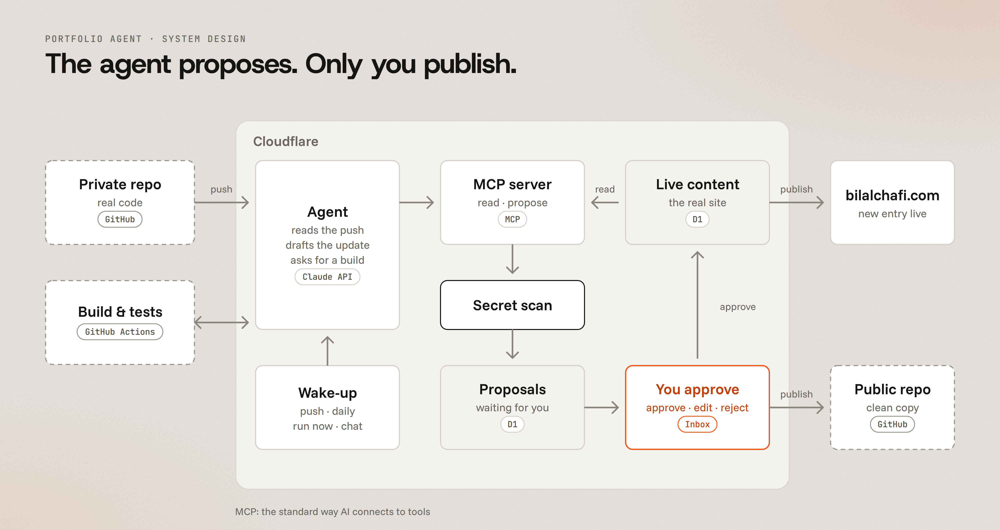

# portfolio-agent

An agent that turns every `git push` into a portfolio update, and waits for my approval before anything goes live.

## Problem

I build client systems in private repos. Showing them means copying the story by hand into my portfolio and into a public GitHub repo, and I fall behind. Letting an AI write straight to the site is no better: it could publish a mistake, or leak a client name or a secret.

## Solution

An agent wakes on each push, reads the change and drafts the portfolio entry. It reaches the site only through an MCP server, and that server lets it read and propose, never publish. Every proposal passes a secret scan, then waits in a queue. Only my approval, from my own logged-in admin, writes to the live site or the public repo.

## System design

The image is drawn from `design/architecture.html`. Edit that file and re-render it when the design changes.
